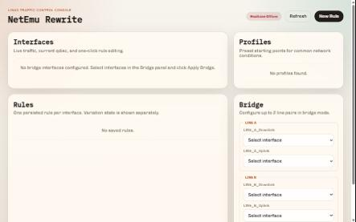
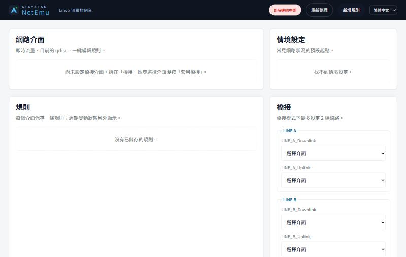
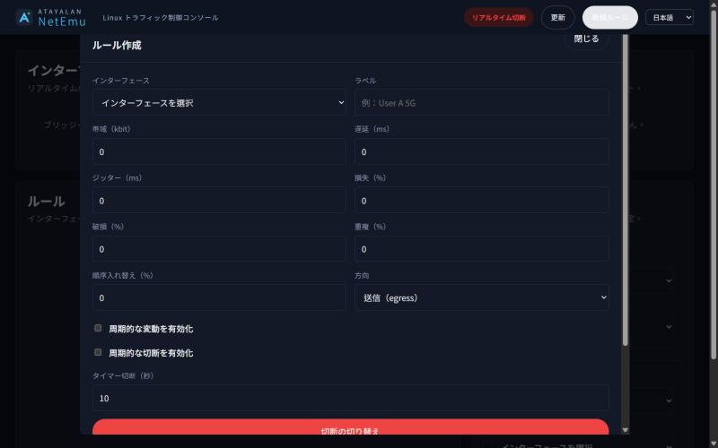

# NetEmu 導入 Atayalan UI Kit（分支 claude/aplus-ui-kit）

- 套件 `dist/` 複製到 `frontend/static/aui/`（後端既有 `/static` 掛載，離線可用）；**拿掉 Google Fonts**（場域離線時原本會退回系統字型）。
- 舊 CSS 變數與寫死的顏色改指向套件 token，支援淺／深色；圓角對齊套件；頂列改成套件深藍頂列＋語言切換。
- 三語：原文是英文，以片語模式提供 zh-TW／ja 對照（`frontend/static/js/i18n-phrases.js`，日文需母語者校對）；預設語言繁中。
- 已翻：靜態介面（57 條）、介面／規則／情境卡片的按鈕與空狀態、即時連線狀態、規則編輯標題。未翻：toast 訊息與後端錯誤訊息。
- 只動 `frontend/`；main 上他人未提交的 `backend/` 修改未受影響。

| 前 | 後（繁中） | 後（日文、深色、規則編輯） |
|---|---|---|
|  |  |  |
