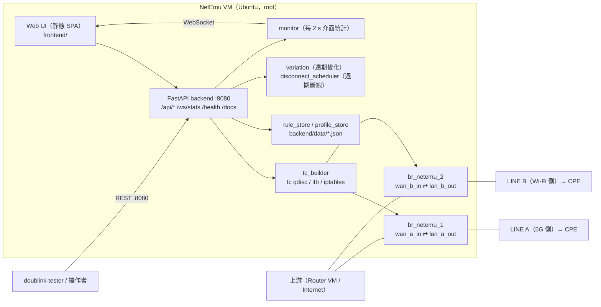
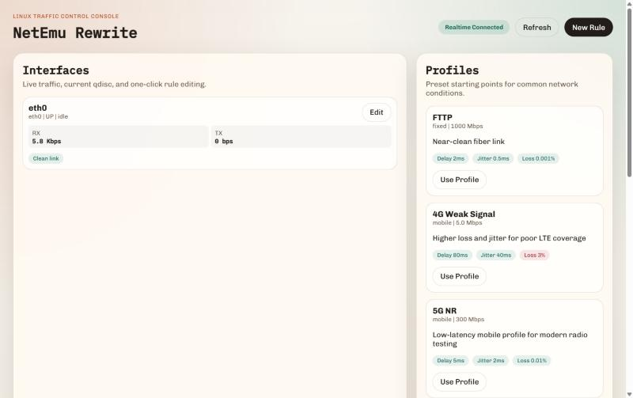
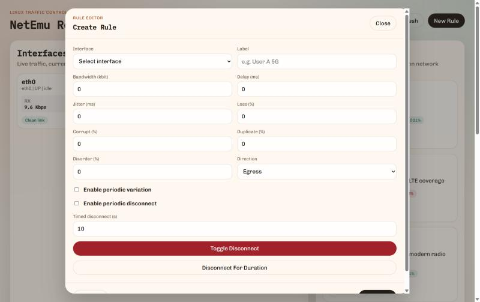
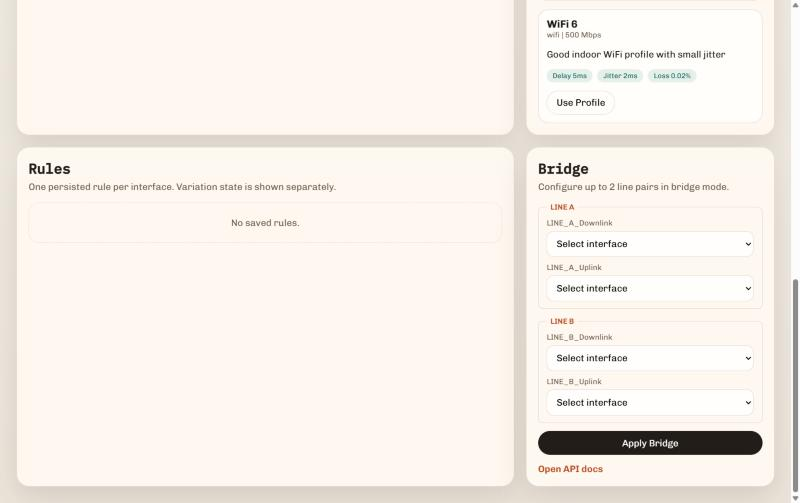

# NetEmu 操作手冊（網路劣化模擬器）

| 項目 | 內容 |
|---|---|
| 文件版本 | **v1.0**（2026-11-22，新建；版本紀錄見第 9 節） |
| 對應程式 | `winson0728/netemu` main `2fba6b4`（服務版本字串 `2.0.0`） |
| 部署實例 | Ataya Lab NetEmu VM（VM 315，`192.168.105.115:8080`），供 doublink-tester 每日回歸使用 |
| 相關文件 | `README.md`；doublink-tester 的 `deploy/netemu/README.md`（開機 bridge 修正）、`docs/TEST_MANUAL.md` §10.2 |

> 本手冊不含任何密碼或 token。NetEmu 本身沒有登入機制，**只應放在受信任的 Lab 管理網段**；VM 的 SSH 帳號向 Lab 管理者取得。

---

## 1. 產品定位與適用場景

NetEmu 是一台以 Linux `tc`（netem＋htb）與 `iptables` 實作的網路劣化模擬器，提供 Web UI 與 REST API。把它以 **bridge** 方式串在受測設備的 WAN 線路上，就能在每條線路上獨立重現頻寬限制、延遲、抖動、遺失、損壞、重複、亂序與週期斷線。

| 場景 | 用法 |
|---|---|
| 多網融合（Doublinks）回歸測試 | 兩組 bridge 分別模擬 LINE A（5G）與 LINE B（Wi-Fi），doublink-tester 透過 API 套用 profile |
| 單線劣化／斷線演練 | UI 選介面、填參數或套用預設 profile，必要時一鍵斷線 |
| 可重現的 A/B 比較 | 開啟週期變化（variation）並設定固定 seed（見 6.2，待確認），讓兩次測試面對相同劣化序列 |

---

## 2. 系統架構



- **方向**：每條規則以 `egress`（預設）、`ingress`（透過 `ifb_<介面>` 重導）或 `both` 作用；在 bridge 拓樸中，`wan_x_in` 的 egress＝該線下行、`lan_x_out` 的 egress＝該線上行。
- **一個介面一條規則**：儲存的規則與實際 `tc` 狀態一一對應；再存一次就是覆寫。
- **持久化**：規則與自訂 profile 存在 `NETEMU_DATA_DIR`（預設 `backend/data/`）；bridge 設定也會保存，**服務啟動時自動重新套用**（`1db1e63` 起）。

---

## 3. 功能清單

| 功能 | 說明 |
|---|---|
| 介面總覽 | 列出介面、狀態、目前 qdisc、即時 RX/TX，並可一鍵編輯 |
| 規則（Rule） | 頻寬（kbit，上限 10 Gbit）、延遲／抖動（ms，上限 60 s）、遺失／損壞／重複／亂序（%） |
| 週期變化（variation） | 每 `interval_s` 秒在 `delay_range_ms`、`jitter_range_ms`、`loss_range_pct`、`bw_range_kbit` 範圍內隨機擾動 |
| 週期斷線（disconnect schedule） | 斷 `disconnect_s` 秒、連 `interval_s` 秒，重複 `repeat` 次（0＝無限） |
| 立即斷線 | Toggle Disconnect（切換），或 Disconnect For Duration（斷 N 秒後自動恢復） |
| Profile | 內建 5 個（FTTP、4G Weak Signal、5G NR、Wi-Fi 6、Satellite GEO），可另存自訂 profile |
| Bridge | 最多 2 組（UI）／4 組（API）線路配對成 bridge |
| 即時統計 | WebSocket `/ws/stats` 推送介面統計 |

---

## 4. 安裝與部署

### 4.1 前置需求

- Ubuntu（建議 22.04／24.04），root 或 `CAP_NET_ADMIN`
- 套件：`python3`、`python3-venv`、`iproute2`、`iptables`、`kmod`；kernel module `sch_netem`、`ifb`
- 至少兩張（每條線路）要串成 bridge 的網卡；Windows 只能編輯原始碼，不能執行 `tc`

### 4.2 一鍵安裝（systemd）

```bash
sudo bash install.sh
```

`install.sh` 依序：安裝系統套件 → 載入並設定開機載入 `sch_netem`、`ifb` → **刪除並重建 `/opt/netemu`**（複製 backend、frontend）→ 建 venv 安裝 `requirements.txt` → 寫入 `/etc/systemd/system/netemu.service`（`uvicorn main:app --host 0.0.0.0 --port 8080`）→ enable 並 restart。

> ⚠️ `install.sh` 會 `rm -rf /opt/netemu`，若資料目錄在 `/opt/netemu/backend/data`，**先備份規則與自訂 profile**（`rules.json`、`custom_profiles.json`、bridge 設定）。

### 4.3 Docker

```bash
docker compose up -d     # network_mode: host，需特權以操作 tc
```

### 4.4 開發模式

```bash
cd backend && pip install -r requirements.txt && sudo python main.py
```

### 4.5 驗證

```bash
systemctl is-active netemu
curl -s http://<host>:8080/health                 # {"status":"ok","service":"NetEmu","version":"2.0.0"}
curl -s http://<host>:8080/api/rules/bridge       # 目前 bridge 設定
ip -br link show type bridge                      # br_netemu_1 / br_netemu_2
```

### 4.6 回復

- 服務層：`sudo systemctl stop netemu` 後清除所有規則（見 5.3），或直接以 `tc qdisc del dev <介面> root` 清除。
- 版本回退：以舊版原始碼重跑 `install.sh`（先備份資料目錄）。
- Lab VM 的開機 bridge 修正（`netemu-bridge-ensure.sh`、`netemu-bridge.service`）屬 doublink-tester repo 管理，移除方式見該處 `deploy/netemu/README.md`。

---

## 5. 日常操作

### 5.1 Web UI

開 `http://<NetEmu>:8080`（Lab：`http://192.168.105.115:8080`）。右上角顯示 WebSocket 狀態（Realtime Connected）、**Refresh**、**New Rule**。


【圖 5-1】Interfaces 與 Profiles（2026-11-22 於工作站 WSL 以非 root、只聽 127.0.0.1 的方式擷取；實際 Lab VM 會看到 `wan_a_in` 等介面）

**建立規則**

1. 在 Interfaces 卡片按 **Edit**，或右上 **New Rule**。
2. 選 Interface、填 Label（如「User A 5G」）。
3. 填 Bandwidth（kbit）、Delay、Jitter（ms）、Loss、Corrupt、Duplicate、Disorder（%），選 Direction（Egress／Ingress／Both）。
4. 需要時勾 **Enable periodic variation**（填範圍與間隔）或 **Enable periodic disconnect**（斷線秒數、間隔、次數）。
5. 存檔後，規則出現在 Rules 區；介面卡片顯示新的 qdisc。


【圖 5-2】Create Rule 對話框

**套用預設 profile**：在 Profiles 區按 **Use Profile**，會帶入規則編輯器，選介面後存檔。

**斷線**：在規則編輯器的 Timed disconnect 填秒數，按 **Disconnect For Duration**；或按 **Toggle Disconnect** 切換斷／通。

**Bridge**：在 Bridge 區為 LINE A、LINE B 各選 Downlink 與 Uplink 介面，按 **Apply Bridge**。


【圖 5-3】Rules 清單與 Bridge 設定

### 5.2 REST API

完整互動文件：`http://<host>:8080/docs`。

| 方法 | 路徑 | 說明 |
|---|---|---|
| GET | `/health` | 健康檢查 |
| GET | `/api/interfaces/` | 介面清單與統計 |
| GET | `/api/interfaces/{name}/stats`、`/{name}/qdisc` | 單一介面統計、目前 qdisc |
| GET／POST | `/api/rules/` | 列出規則／新增或覆寫規則（一介面一條） |
| GET | `/api/rules/{rule_id}` | 讀一條規則 |
| POST | `/api/rules/{rule_id}/clear` | 清除該規則的 tc 設定 |
| DELETE | `/api/rules/{rule_id}` | 刪除規則 |
| POST | `/api/rules/disconnect` | `{"interface":"…","disconnect":true/false}` 立即斷／通 |
| GET／POST | `/api/rules/bridge` | 讀／設定 bridge：`{"lines":[{"downlink":"wan_a_in","uplink":"lan_a_out"},…]}` |
| POST | `/api/schedule/disconnect` | `{"interface":"…","duration_s":5}` 斷線 N 秒 |
| GET／POST／DELETE | `/api/profiles/`、`/api/profiles/{id}` | profile 清單、新增自訂、刪除 |
| WS | `/ws/stats` | 即時介面統計 |

範例（套用 5G 側 50 ms／1% 遺失）：

```bash
curl -X POST http://192.168.105.115:8080/api/rules/ -H 'Content-Type: application/json' \
  -d '{"interface":"wan_a_in","label":"5G DL","delay_ms":50,"loss_pct":1,"direction":"egress"}'
```

### 5.3 常用維運

```bash
sudo systemctl status netemu
sudo journalctl -u netemu -f
curl -s http://<host>:8080/api/rules/ | python3 -m json.tool       # 目前規則
tc qdisc show                                                       # 實際 tc 狀態
```

---

## 6. 設定參數說明

### 6.1 環境變數

| 變數 | 預設 | 說明 |
|---|---|---|
| `NETEMU_HOST` | `0.0.0.0` | 監聽位址 |
| `NETEMU_PORT` | `8080` | 監聽埠 |
| `NETEMU_DATA_DIR` | `backend/data` | 規則、自訂 profile、bridge 設定 |
| `NETEMU_MONITOR_INTERVAL_S` | `2.0` | 統計推送間隔 |
| `NETEMU_ALLOWED_ORIGINS` | `http://localhost:8080,http://127.0.0.1:8080` | CORS 允許來源 |

### 6.2 可重現的週期變化（待確認）

doublink-tester 以 `NETEMU_VARIATION_SEED=42` 讓 variation 逐封包可重現。對應的 NetEmu 程式（`settings.py` 讀 `NETEMU_VARIATION_SEED`、`variation.py` 每條規則用自己的 RNG）**目前只在工作站 `C:\codex-workspace\netemu` 的未提交變更中，尚未進 Git**；Lab VM 上實際執行的版本是否含此功能待確認。未設定時 variation 維持隨機。

### 6.3 規則欄位

| 欄位 | 範圍 | 說明 |
|---|---|---|
| `bandwidth_kbit` | 0–10,000,000 | 0＝不限速 |
| `delay_ms` / `jitter_ms` | 0–60,000 | netem delay／jitter |
| `loss_pct` / `corrupt_pct` / `duplicate_pct` / `disorder_pct` | 0–100 | netem 參數 |
| `direction` | `egress`／`ingress`／`both` | ingress 透過 `ifb_<介面前 11 字>` |
| `variation` | `delay_range_ms`、`jitter_range_ms`、`loss_range_pct`、`bw_range_kbit`、`interval_s`（1–3600） | 需 `variation_enabled: true` |
| `disconnect_schedule` | `enabled`、`disconnect_s`（0.5–3600）、`interval_s`（1–86400）、`repeat`（0＝無限） | 週期斷線 |

---

## 7. 常見問題與故障排除

| 症狀 | 原因與處理 |
|---|---|
| VM 開機後受測設備兩條線都斷 | bridge 成員沒有掛回 `br_netemu_*`。新版啟動時會自動重套已保存的 bridge；Lab VM 另有 `netemu-bridge.service` 保險。手動：`POST /api/rules/bridge` |
| `systemd-networkd` 重啟（如自動更新）後斷線 | 同上，介面會掉出 bridge；重套 bridge |
| `tc` 錯誤、規則狀態顯示 `tc_errors` | 介面不存在、缺 `sch_netem`／`ifb` 模組，或沒有 root；看 `journalctl -u netemu` |
| 60M kbit 限速實測只有 25–30 Mbps | htb 在此拓樸的實際開銷，見 doublink-tester TEST_MANUAL §9 |
| `GET /api/rules/bridge` 回 404 | 舊版路由順序問題，`2fba6b4` 已修 |
| UI 顯示 Offline | WebSocket 斷線；按 Refresh 或檢查跨來源設定 `NETEMU_ALLOWED_ORIGINS` |
| 長測期間 VM 自動更新干擾 | doublink-tester 長測會暫停 `apt-daily-upgrade.timer` 並在結束後還原（見該 repo 的 A+ DLT-03 說明） |

---

## 8. 安全注意事項

- 沒有登入與權限控管，任何能連到 8080 的人都能改規則、斷線：只開放給 Lab 管理網段。
- 以 root 執行（需要 `tc`）。所有指令以參數陣列呼叫，不經 shell。
- 不要把 NetEmu 放在承載正式流量的路徑上。

---

## 9. 版本與變更紀錄

### 9.1 文件

| 版本 | 日期 | 變更 |
|---|---|---|
| v1.0 | 2026-11-22 | 新建：定位、架構（Mermaid）、功能、安裝部署與回復、UI 逐步操作（截圖）、API、參數、FAQ |

### 9.2 程式（`git log`，最近）

| commit | 內容 |
|---|---|
| `2fba6b4` | `GET /bridge` 路由移到 `/{rule_id}` 之前，修路徑衝突 |
| `1db1e63` | 啟動時自動套用 bridge、精簡 UI、以 `ip link` 實作斷線 |
| `c3f60be` | UI：bps 單位、只列 bridge 介面、checkbox 修正 |

### 9.3 待確認

1. 6.2 的 variation seed 功能尚未提交（工作站未提交變更）；是否提交、Lab VM 是否已部署，待確認。
2. 圖 5-1～5-3 是 `origin/main` 版在工作站 WSL 的畫面（只有 `eth0`），Lab VM 的實際畫面（含 `wan_a_in` 等）可在 Lab 擷取；UI 統一風格工作完成後重拍。
3. Lab VM 上 `/opt/netemu` 的實際版本與本 repo 的對應待核對（工作站另有 `netemu-update-v4.tar.gz`、`netemu.tar_1.gz`，未入 Git）。
